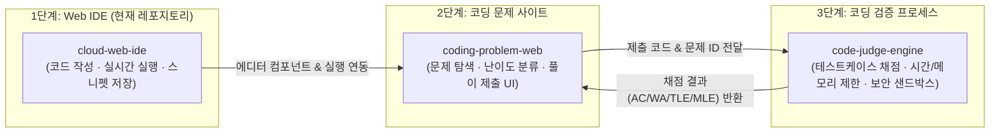
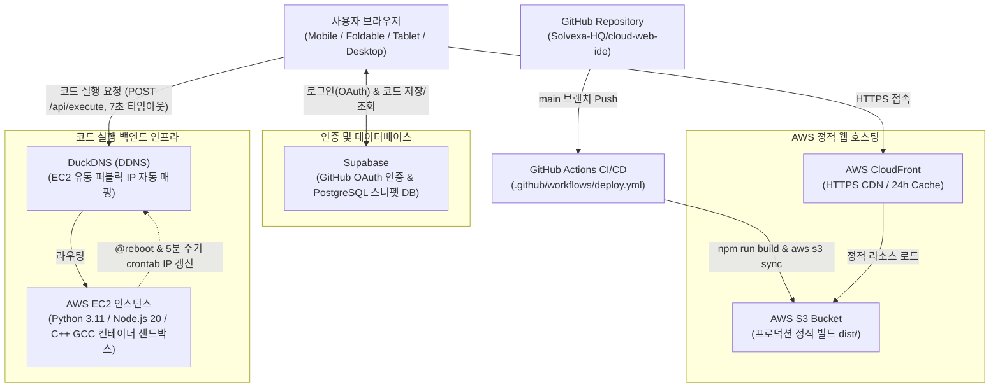

# Solvexa-HQ | Cloud Web IDE (`fold-ide-web`)

> **Solvexa-HQ 웹 코딩 플랫폼 프로젝트 (Phase 1: Cloud Web IDE)**  
> AWS(S3, CloudFront, EC2 컨테이너 샌드박스)와 Supabase를 활용하여 모바일(폴더블 포함), 태블릿, 데스크톱 어디서나 코드를 작성·실행·저장할 수 있는 크로스플랫폼 클라우드 웹 IDE입니다.

---

## 1. 프로젝트 소개 및 플랫폼 로드맵

**Cloud Web IDE**는 별도의 로컬 개발 환경 구축 없이 웹 브라우저에서 즉시 코드를 작성하고 실행할 수 있는 클라우드 기반 통합 개발 환경이며, **Solvexa-HQ가 구축하는 통합 웹 코딩 플랫폼의 1단계 핵심 엔진**입니다.

### Solvexa-HQ 웹 코딩 플랫폼 3단계 로드맵 및 레포지토리 구조
Solvexa-HQ Organization 하위에서 각 단계별 역할을 독립된 레포지토리(마이크로서비스/모듈형)로 분리하여 관리합니다.



| 단계 | 구분 | 권장 레포지토리명 (예시) | 핵심 역할 및 목표 | 상태 |
| :---: | :--- | :--- | :--- | :---: |
| **1단계** | **Web IDE 제작** | `Solvexa-HQ/cloud-web-ide` | 다중 언어 웹 에디터, 원격 컨테이너 실행, 클라우드 코드 저장 및 모바일/PC 반응형 UI 완성 | **진행 중 (v1.4)** |
| **2단계** | **코딩 문제 사이트 제작** | `Solvexa-HQ/coding-problem-web` | 알고리즘/코딩 문제 목록, 문제 상세 설명, 입출력 예제 제공 및 1단계 Web IDE 결합 | 기획 완료 |
| **3단계** | **코딩 검증 프로세스 제작** | `Solvexa-HQ/code-judge-engine` | 비동기 메시지 큐 기반 다중 테스트케이스 자동 채점, 실행 시간/메모리 측정 및 샌드박스 격리 | 기획 완료 |

---

## 2. 시스템 아키텍처 (Phase 1: Cloud Web IDE)



### 주요 기능
- **다중 언어 코드 실행 (AWS EC2 샌드박스 연동)**
  - Python 3.11, Node.js 20 (JavaScript), C++ (GCC) 문법 하이라이팅 및 원격 컨테이너 실행을 지원합니다.
- **사용자 인증 및 실행 권한 제어 (Supabase Auth)**
  - GitHub OAuth 로그인을 지원하며, 무분별한 서버 리소스 호출을 방지하기 위해 로그인한 사용자만 코드 실행 및 클라우드 저장을 사용할 수 있습니다.
- **클라우드 코드 스니펫 저장 및 불러오기 (Supabase Database)**
  - 작성한 코드를 파일명·언어와 함께 클라우드 DB에 저장하고 언제든 목록에서 불러올 수 있습니다.
- **EC2 서버 비활성화(절전) 감지 및 타임아웃 제어**
  - 비용 절약을 위해 AWS EC2 서버가 중지(OFF)된 상태이거나 네트워크가 불안정할 때 무한 대기하지 않도록 타임아웃(7초)을 적용하고 명확한 안내 메시지를 출력합니다.
- **모바일 및 폴더블 최적화 UI**
  - `visualViewport` API를 통해 모바일 가상 키보드 활성화 시 레이아웃을 자동 조정하며, 빠른 기호 입력 바(`Tab`, `{}`, `()`, `;` 등)를 제공합니다.
- **AWS S3 + CloudFront 정적 웹 호스팅 및 GitHub Actions 자동 배포 (CI/CD)**
  - `main` 브랜치에 Push할 때마다 GitHub Actions가 프로덕션 번들(`dist/`)을 빌드하여 AWS S3 버킷에 자동으로 동기화하며, CloudFront를 통해 HTTPS 보안 연결로 서비스됩니다.

### 기술 스택
- **Frontend**: React 19, Vite 8, Tailwind CSS v4, CodeMirror 6 (`@uiw/react-codemirror`), Lucide React
- **Authentication & Database**: Supabase (`@supabase/supabase-js`, GitHub OAuth)
- **Code Execution Backend**: AWS EC2 컨테이너 샌드박스 API + DuckDNS (DDNS)
- **Deployment & CI/CD**: AWS S3 Static Website Hosting, AWS CloudFront (HTTPS), GitHub Actions

---

## 3. 프로젝트 구조

```text
fold-ide-web/
├── .github/
│   └── workflows/
│       └── deploy.yml       # GitHub Actions 기반 AWS S3 자동 빌드/배포 워크플로우
├── dist/                    # 프로덕션 빌드 결과물 폴더 (S3 업로드 대상, Git 추적 제외)
├── public/                  # 정적 에셋 폴더 (파비콘, 아이콘 등)
├── src/
│   ├── assets/              # 이미지 및 SVG 리소스
│   ├── App.jsx              # 메인 IDE 컴포넌트 (에디터, 인증, 코드 실행, 클라우드 저장/목록 UI)
│   ├── App.css              # 보조 컴포넌트 스타일시트
│   ├── supabaseClient.js    # 환경 변수 기반 Supabase 클라이언트 초기화 모듈
│   ├── index.css            # Tailwind CSS 로드 및 모바일 터치/에디터 전역 스타일
│   └── main.jsx             # React 앱 엔트리 포인트 (DOM 마운트)
├── .env                     # 실제 환경 변수 파일 (보안을 위해 Git 추적 제외)
├── .env.example             # 협업 팀원을 위한 환경 변수 설정 템플릿 파일
├── .gitignore               # 보안 민감 파일(.env, 인증키 등) 및 빌드 산출물(dist) Git 제외 설정
├── eslint.config.js         # ESLint 코드 품질 규칙 설정
├── index.html               # HTML 루트 템플릿
├── package.json             # 프로젝트 의존성 패키지 및 실행 스크립트 정의
├── vite.config.js           # Vite 빌드 및 React/Tailwind 플러그인 설정
└── README.md                # 프로젝트 소개, 아키텍처, 협업 가이드 및 버전 이력 문서
```

---

## 4. 공동작업 및 로컬 개발 환경 구축 가이드 (Collaboration Guide)

### 1) 로컬 개발 환경 세팅
새로운 팀원이 프로젝트를 클론하여 로컬에서 실행하는 절차입니다.

```bash
# 1. 그룹 레포지토리 클론 및 폴더 이동
git clone https://github.com/Solvexa-HQ/cloud-web-ide.git
cd cloud-web-ide

# 2. 의존성 패키지 설치
npm install

# 3. 환경 변수 파일(.env) 생성 (.env.example 템플릿 복사)
cp .env.example .env
```

생성된 `.env` 파일을 열어 실제 프로젝트의 환경 변수 값을 입력합니다:
```env
VITE_SUPABASE_URL=https://<YOUR_PROJECT_ID>.supabase.co
VITE_SUPABASE_ANON_KEY=<YOUR_SUPABASE_PUBLISHABLE_ANON_KEY>
VITE_API_BASE_URL=https://<YOUR_BACKEND_DOMAIN>.duckdns.org
```

```bash
# 4. 로컬 개발 서버 실행 (http://localhost:5173)
npm run dev

# 5. 코드 린트 검사 및 프로덕션 빌드 테스트
npm run lint
npm run build
```

### 2) 브랜치 전략 및 커밋 컨벤션
- **브랜치 규칙**:
  - `main`: AWS S3로 자동 배포되는 운영(Production) 브랜치
  - `feat/<기능명>`: 새로운 기능 개발 (예: `feat/theme-toggle`, `feat/multi-tab`)
  - `fix/<이슈명>`: 버그 수정 (예: `fix/mobile-keyboard-resize`)
  - `docs/<문서명>`: 문서 및 README 수정
- **커밋 메시지 컨벤션**:
  - `feat:` 새로운 기능 추가
  - `fix:` 버그 및 예외 처리 수정
  - `docs:` README 등 문서 수정
  - `chore:` 빌드 설정, 패키지 매니저, 환경 변수 설정 변경
  - `refactor:` 기능 변경 없는 코드 구조 개선

---

## 5. 인프라 운영 가이드 (S3 / CloudFront / EC2 DDNS)

### 1) AWS S3 수동 업로드 및 GitHub Actions 자동 배포 설정
- **GitHub Actions 자동 배포 시 필요한 Repository Secrets (`Settings → Secrets and variables → Actions`)**:
  - `VITE_SUPABASE_URL` : Supabase 프로젝트 URL
  - `VITE_SUPABASE_ANON_KEY` : Supabase Anon Key
  - `VITE_API_BASE_URL` : EC2 백엔드 도메인 주소
  - `AWS_ACCESS_KEY_ID` : S3 업로드 권한(`AmazonS3FullAccess`)이 있는 AWS IAM 사용자의 Access Key
  - `AWS_SECRET_ACCESS_KEY` : 해당 IAM 사용자의 Secret Access Key
  - `AWS_S3_BUCKET` : 배포 대상 S3 버킷 이름
- **Supabase OAuth Redirect 설정**:
  - **Supabase 콘솔 → Authentication → URL Configuration**의 `Site URL` 및 `Redirect URLs`에 배포된 CloudFront(`https://<CLOUDFRONT_DOMAIN>.cloudfront.net`) 및 S3 엔드포인트 주소를 등록해야 GitHub 로그인이 정상 작동합니다.

### 2) AWS CloudFront 24시간 캐시 정책 및 무효화(Invalidation)
- S3 앞단에 **AWS CloudFront(HTTPS)**를 연결하여 사용할 경우, 기본 캐시 유지 시간(TTL, 24시간) 동안 이전 `index.html`이 캐싱되어 제공됩니다.
- 24시간 뒤 캐시가 만료되면 최신 배포본이 자동 반영되며, 긴급하게 즉시 반영이 필요한 경우에만 **AWS 콘솔 → CloudFront → [무효화(Invalidations)] → [무효화 생성]**에서 경로에 `/*`를 입력하여 1회성 캐시 초기화를 수행합니다.

### 3) EC2 SSH 접속 및 DuckDNS 유동 IP 자동 갱신 설정
비용 절약을 위해 유료 탄력적 IP(Elastic IP) 대신 기본 퍼블릭 IP를 사용하면서, EC2 재시작 시 바뀌는 IP를 DuckDNS에 자동 반영하는 설정입니다.

1. **EC2 서버 SSH 접속**
   ```powershell
   ssh -i "<KEY_FILE_PATH>.pem" ubuntu@<YOUR_DOMAIN>.duckdns.org
   ```
2. **EC2 내부에 DuckDNS IP 갱신 스크립트(`~/duckdns.sh`) 생성**
   ```bash
   cat << 'EOF' > ~/duckdns.sh
   #!/bin/bash
   curl -s "https://www.duckdns.org/update?domains=<YOUR_DOMAIN>&token=<YOUR_DUCKDNS_TOKEN>&ip=" > ~/duckdns.log 2>&1
   EOF
   chmod +x ~/duckdns.sh
   ~/duckdns.sh
   ```
3. **서버 부팅 시(`@reboot`) 및 5분 주기 자동 실행 등록 (`crontab`)**
   ```bash
   (crontab -l 2>/dev/null | grep -v "duckdns.sh"; echo "@reboot sleep 10 && ~/duckdns.sh"; echo "*/5 * * * * ~/duckdns.sh") | crontab -
   ```

---

## 6. 버전 이력 관리 (Changelog)

### v1.4 (현재 버전)
**Solvexa-HQ 그룹(Organization) 레포지토리 전환 및 웹 코딩 플랫폼 포트폴리오/협업 문서화**가 반영되었습니다.
1. **그룹 레포지토리(`Solvexa-HQ/cloud-web-ide`) 전환 및 3단계 플랫폼 로드맵 수립**
   - 1단계(Web IDE) → 2단계(코딩 문제 사이트) → 3단계(코딩 검증 프로세스)로 이어지는 전체 플랫폼 아키텍처 및 멀티 레포지토리 구조 정의.
2. **시스템 아키텍처 시각화 (Mermaid 다이어그램)**
   - 프론트엔드(CloudFront/S3), 인증/DB(Supabase), 코드 실행 샌드박스(DuckDNS/EC2), CI/CD(GitHub Actions) 간의 전체 데이터 흐름도 추가.
3. **공동작업 지원용 `.env.example` 템플릿 및 협업 가이드 추가**
   - 실제 시크릿 값을 노출하지 않고 팀원이 즉시 개발 환경을 세팅할 수 있도록 `.env.example` 파일을 추가하고 로컬 설치·브랜치·커밋 컨벤션 문서화.

### v1.3
1. **AWS S3 정적 배포용 프로덕션 빌드(`dist/`) 구성 및 격리**
2. **GitHub Actions 기반 AWS S3 자동 배포 파이프라인 구축 (`.github/workflows/deploy.yml`)**
3. **AWS CloudFront 24시간 캐시 정책 및 무효화(`/*`) 운영 가이드 정리**
4. **과거 Git 커밋 히스토리 보안 클린업 (History Sanitization)**

### v1.2
1. **EC2 백엔드 API 주소 환경 변수(`.env` → `VITE_API_BASE_URL`) 분리 및 은폐**
2. **EC2 재시작 시 유동 퍼블릭 IP 변경 대응 (DuckDNS DDNS + `crontab` 자동 업데이트 적용)**

### v1.1
1. **비로그인 상태 코드 실행 차단 (실행 버튼 비활성화 및 단축키 방어)**
2. **AWS EC2 서버 OFF 대응 및 무한 대기 방지 (`AbortController` 7초 타임아웃 및 안내 메시지 처리)**
3. **코드 한글 주석 정리 및 ESLint React Hooks 오류 해결**
4. **`.gitignore` 보안 강화 (`.env.*`, `*.pem`, `*.key`, `.aws/` 등 차단)**

### v1.0 (초기 버전)
- Python 3.11, Node.js 20, C++ (GCC) 지원 CodeMirror 6 기반 웹 에디터 구현
- AWS EC2 백엔드 서버 연동 코드 실행 및 콘솔 출력 기능 구현
- Supabase GitHub OAuth 로그인 및 코드 스니펫 클라우드 저장/불러오기 모달 구현
- 모바일 가상 키보드 대응 뷰포트 리사이징 및 빠른 특수문자 입력 바 구현
