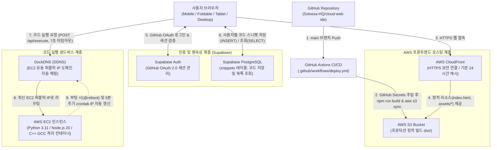
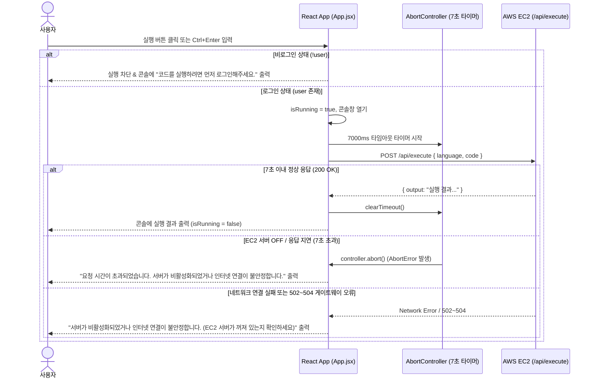

# 1단계 Cloud Web IDE 시스템 아키텍처 및 내부 동작 상세

[← 메인 README로 돌아가기](../README.md)

---

## 1. 전체 인프라 및 통신 아키텍처

1단계 **Cloud Web IDE (`cloud-web-ide`)**는 정적 프론트엔드(AWS S3 + CloudFront), 인증 및 데이터베이스(Supabase), 그리고 코드 실행 샌드박스 백엔드(DuckDNS + AWS EC2)의 3계층 구조로 동작합니다.

---

## 2. 코드 실행 및 예외 처리 시퀀스 (`handleExecute`)

사용자가 `실행` 버튼을 클릭하거나 에디터 내에서 `Ctrl+Enter` (`Cmd+Enter`)를 입력했을 때의 내부 검증 및 타임아웃 흐름입니다.

---

## 3. 프론트엔드 주요 상태 및 모바일 최적화 설계 (`src/App.jsx`)

1. **에디터 및 코드 실행 상태**
   - `language`: 현재 선택된 언어 (`python` | `javascript` | `cpp`). 변경 시 `DEFAULT_CODE[newLang]`으로 에디터 초기 템플릿을 전환합니다.
   - `code`: CodeMirror 에디터에 작성 중인 소스 코드 본문 상태입니다.
   - `output`: 우측(데스크톱) 또는 하단(모바일) 콘솔에 표시되는 실행 결과 또는 오류 안내 메시지입니다.
   - `isRunning`: 코드 실행 요청 진행 여부 상태이며, 실행 중에는 중복 요청을 막기 위해 실행 버튼을 비활성화하고 로딩 스피너(`Loader2`)를 표시합니다.

2. **모바일/폴더블 반응형 뷰포트 및 빠른 기호 입력 바**
   - `viewportHeight` & `isKeyboardOpen`: `window.visualViewport`의 `resize` 이벤트를 구독하여, 모바일에서 가상 키보드가 화면 높이의 25% 이상을 차지할 경우 키보드 활성화로 판단하고 모바일(`window.innerWidth < 768`)에서 콘솔창을 자동으로 닫아 코드 편집 시야를 확보합니다.
   - `QUICK_SYMBOLS`: 모바일 터치 환경에서 입력하기 까다로운 괄호 쌍(`{}`, `()`, `[]`), 따옴표(`""`, `''`), 들여쓰기(`Tab` 4칸), 세미콜론(`;`), 콜론(`:`), 커서 좌우 이동(`←`, `→`)을 에디터 트랜잭션(`view.dispatch`)으로 즉시 삽입하고 커서를 괄호 안쪽(`offset: -1`)으로 자동 위치시킵니다.

3. **Supabase 인증 및 클라우드 스니펫 연동**
   - 앱 마운트 시 `supabase.auth.getSession()`과 `supabase.auth.onAuthStateChange()`를 통해 GitHub OAuth 세션을 실시간으로 동기화합니다.
   - 로그인된 사용자의 `user.id`를 기준으로 `snippets` 테이블에서 최신 수정순(`updated_at DESC`)으로 저장된 코드 목록을 조회하며, 저장 모달에서 항목 클릭 시 제목·언어·코드를 에디터로 즉시 복원합니다.
