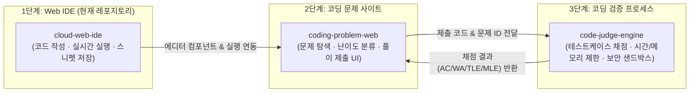
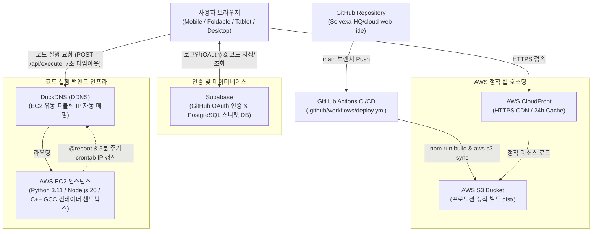

# 플랫폼 로드맵 및 시스템 아키텍처

[← 메인 README로 돌아가기](../README.md)

---

## 1. Solvexa-HQ 웹 코딩 플랫폼 3단계 로드맵

**Solvexa-HQ**는 단일 Web IDE를 넘어, 문제 출제·풀이·자동 채점까지 아우르는 통합 웹 코딩 플랫폼을 구축하고 있습니다. 각 단계는 독립된 레포지토리로 분리하여 개발 및 관리합니다.

| 단계 | 구분 | 권장 레포지토리명 | 핵심 역할 및 목표 | 상태 |
| :---: | :--- | :--- | :--- | :---: |
| **1단계** | **Web IDE 제작** | `Solvexa-HQ/cloud-web-ide` | 다중 언어 웹 에디터, 원격 컨테이너 실행, 클라우드 코드 저장 및 모바일/PC 반응형 UI 완성 | **진행 중** |
| **2단계** | **코딩 문제 사이트 제작** | `Solvexa-HQ/coding-problem-web` | 알고리즘/코딩 문제 목록, 문제 상세 설명, 입출력 예제 제공 및 1단계 Web IDE 결합 | 기획 완료 |
| **3단계** | **코딩 검증 프로세스 제작** | `Solvexa-HQ/code-judge-engine` | 비동기 메시지 큐 기반 다중 테스트케이스 자동 채점, 실행 시간/메모리 측정 및 샌드박스 격리 | 기획 완료 |

---

## 2. 시스템 아키텍처 (Phase 1: Cloud Web IDE)

